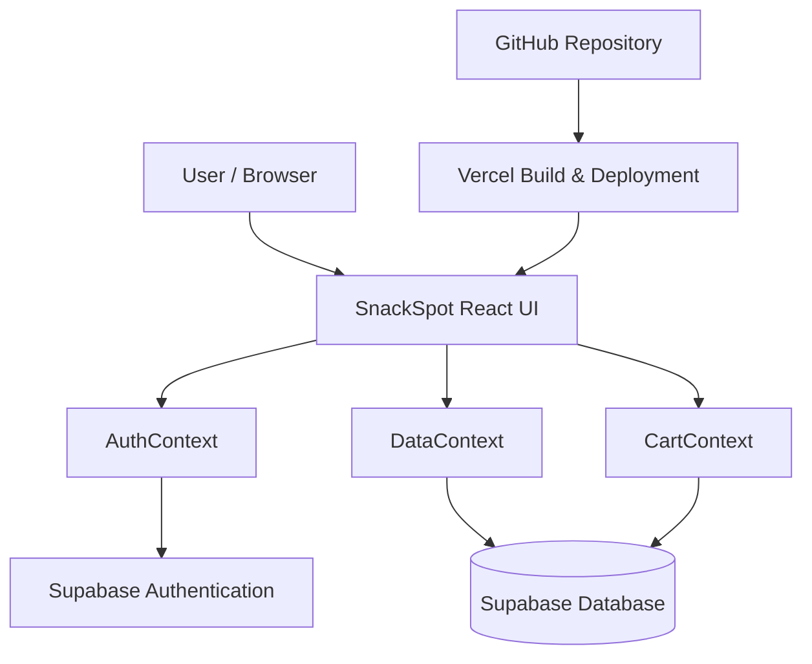
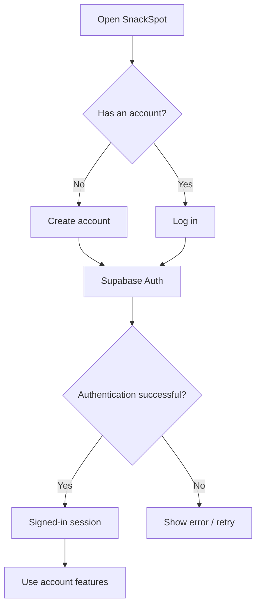
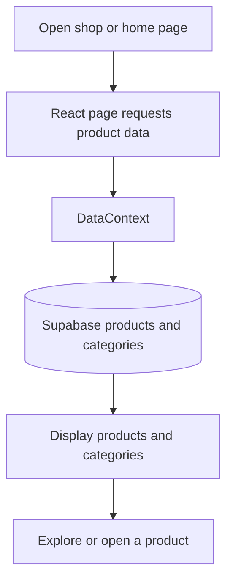
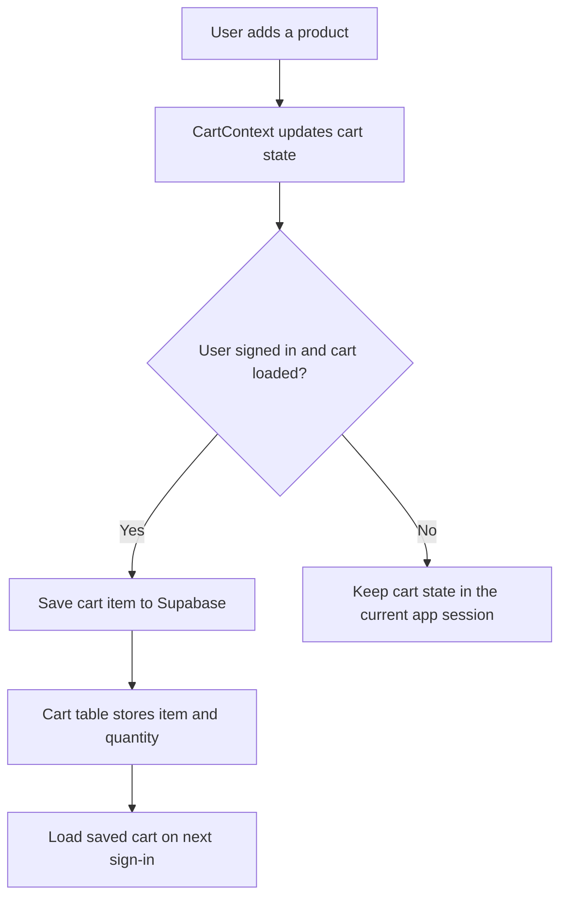
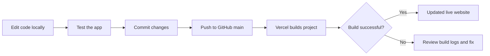

SnackSpot 🍿
A modern online snack-shopping experience
SnackSpot is a responsive e-commerce website where users can browse
snacks, create an account, and manage a shopping cart. The frontend is
built with React and Tailwind CSS, while Supabase provides
authentication and database services. The app is deployed on Vercel and
connected to GitHub for automatic deployments.
Live demo: Add your Vercel URL here
Repository: https://github.com/Rishipatel10/SnackSpot

Table of Contents
- Features
- Technology Stack
- Architecture
- Main User Flows
- Database Design
- Project Structure
- Run Locally
- Environment Variables
- Deployment
- Example User Journey
- Security Notes
- Future Improvements
Features
- Browse snack products and categories.
- View product details and discover featured products.
- Search and explore products using the website interface.
- Sign up, log in, and log out with Supabase Authentication.
- Add products to the shopping cart and change quantities.
- Save cart items to Supabase for the signed-in user.
- Responsive interface with desktop and mobile navigation.
- Deploy the website through Vercel, with source code hosted on
  GitHub.
Feature availability may depend on the current implementation in the
repository. Checkout/payment processing is not described as implemented
here.
Technology Stack
  Technology                          Purpose
  React                               Builds the user interface from
                                      reusable components

  Vite                                Runs the development server and
                                      builds the frontend

  Tailwind CSS                        Styles the interface and supports
                                      responsive layouts

  Supabase Auth                       Handles user sign-up, login,
                                      sessions, and logout

  Supabase Database                   Stores product data and signed-in
                                      users' cart items

  Git and GitHub                      Tracks and hosts the source code

  Vercel                              Hosts the production website and
                                  can deploy updates from GitHub
Architecture

How it works
1. The user opens SnackSpot in a browser.
2. React components display the shop, product, account, and cart
   interfaces.
3. AuthContext manages the current Supabase-authenticated user.
4. DataContext retrieves product and category data from Supabase.
5. CartContext loads and saves cart items for the signed-in user's
   account.
6. GitHub stores the code, and Vercel builds and hosts the website.
Main User Flows
1. Sign-up and login

Supabase Authentication manages the user account and session. If email
confirmation is enabled in the Supabase project, a new user may need to
confirm their email before signing in.
2. Product browsing

The product and category information is loaded from Supabase through the
application's data context.
3. Shopping cart

Cart records are associated with the authenticated user's ID. The
database uses a unique combination of user_id and cart_id, and the
app uses an upsert operation to insert or update a cart row.
Note: The current implementation also writes cart state to browser
localStorage. Supabase is used to persist the signed-in user's cart.
Verify the current code if you change the cart persistence behavior.

4. Code update and deployment

When the Vercel project is connected to the GitHub repository, pushes to
the configured production branch can trigger a new deployment.
Database Design
SnackSpot uses Supabase. The current implementation includes
product/category data and a cart_items table for cart persistence.
cart_items
  Column             Purpose
  id               Database-generated row ID
  user_id          ID of the Supabase user who owns the cart item
  cart_id          Cart item's application-level identifier
  product_id       Product identifier
  name             Product name saved with the cart item
  price            Current item price
  original_price   Optional original price
  weight           Optional product weight/size
  image            Optional product image reference
  quantity         Quantity; must be greater than zero
  created_at       Time the row was created

Relationship and access
- user_id references auth.users(id).
- A unique constraint on (user_id, cart_id) prevents duplicate cart
  identifiers for the same user.
- Row Level Security (RLS) policies should ensure a user can only
  select, insert, update, or delete rows where user_id = auth.uid().
- The user ID should come from the authenticated Supabase session, not
  from a value a visitor can freely choose.
Example cart record
The following is illustrative sample data, not a record copied from the
live database:
{
  "user_id": "authenticated-user-uuid",
  "cart_id": "cart-item-123",
  "product_id": "snack-001",
  "name": "Roasted Snack Mix",
  "price": 149.00,
  "original_price": 179.00,
  "weight": "200 g",
  "image": "/images/snack-mix.png",
  "quantity": 2
}
Project Structure
SnackSpot/
├── public/                     # Public static assets
├── src/
│   ├── assets/                 # Images and other assets
│   ├── components/
│   │   ├── common/             # Navbar, cart drawer, modals, footer, toast
│   │   ├── home/               # Homepage sections
│   │   ├── mobile/             # Mobile navigation components
│   │   ├── product/            # Product details UI
│   │   └── shop/               # Shop page, product card, filters
│   ├── context/
│   │   ├── AuthContext.jsx     # Authentication state and actions
│   │   ├── CartContext.jsx     # Cart state and persistence
│   │   ├── DataContext.jsx     # Product and category data
│   │   └── WishlistContext.jsx # Wishlist state
│   ├── data/
│   │   └── products.js         # Product-related data/constants
│   ├── lib/
│   │   └── supabaseClient.js   # Supabase client setup
│   ├── App.jsx                 # App composition and providers
│   ├── App.css
│   ├── index.css
│   └── main.jsx                # React entry point
├── index.html
├── package.json
├── vite.config.js
└── README.md
Run Locally
Requirements
- Node.js and npm
- A Supabase project
- Git (optional, but recommended)
1. Clone the repository
git clone https://github.com/Rishipatel10/SnackSpot.git
cd SnackSpot
2. Install dependencies
npm install
3. Configure environment variables
Create a .env file in the project root. Use the variable names
expected by src/lib/supabaseClient.js:
VITE_SUPABASE_URL=https://YOUR_PROJECT_ID.supabase.co
VITE_SUPABASE_ANON_KEY=YOUR_SUPABASE_PUBLISHABLE_OR_ANON_KEY
Replace the example values with the URL and publishable/legacy anon key
from your own Supabase project. Do not add a Supabase service_role or
secret key to frontend environment variables.
4. Start the development server
npm run dev
Open the local URL printed by Vite in your terminal (usually
http://localhost:5173).
5. Build for production
npm run build
To preview the production build locally:
npm run preview
Environment Variables
  Variable                            Description
  VITE_SUPABASE_URL                 Supabase project URL, for example
                                      https://YOUR_PROJECT_ID.supabase.co

  VITE_SUPABASE_ANON_KEY            Supabase publishable key or legacy anon
                                  key used by the frontend
Vite exposes variables prefixed with VITE_ to browser-side code. Treat
these values as public. The publishable/anon key is designed for client
applications when database permissions and RLS policies are configured
correctly. Never expose a service-role key or other privileged secret in
the frontend.

After changing environment variables in Vercel, redeploy the project for
the new values to take effect.
Deployment
Deploy using Vercel
1. Push the project to GitHub.
2. In Vercel, create a project and import Rishipatel10/SnackSpot.
3. Select Vite as the framework preset.
4. Use npm run build as the build command and dist as the output
   directory.
5. Add VITE_SUPABASE_URL and VITE_SUPABASE_ANON_KEY under
   Environment Variables for the required environments.
6. Deploy and open the production URL.
7. Test sign-up/login, product loading, cart updates, and cart
   persistence on the deployed website.
Publish later changes
git add .
git commit -m "Describe your change"
git push
If GitHub is connected to Vercel's production branch, Vercel can build
and deploy the new commit automatically.
Example User Journey
1. A visitor opens SnackSpot and explores available snacks.
2. The visitor creates an account or logs in.
3. The user adds a snack to the cart and increases its quantity.
4. CartContext updates the cart and saves the signed-in user's cart
   to Supabase.
5. The user logs out and later signs in again.
6. The app loads that user's saved cart from Supabase.
Security Notes
- Enable and test RLS on tables exposed to the frontend.
- Restrict cart operations to the authenticated user's own rows.
- Keep privileged Supabase keys out of the frontend and Git
  repository.
- Do not commit .env files. Keep .env in .gitignore.
- Validate prices and order totals on a trusted server before
  implementing real payments or order fulfillment.
- Configure Supabase Authentication redirect URLs for the deployed
  Vercel domain when required.
Future Improvements
- Complete wishlist persistence in Supabase.
- Add checkout and order history.
- Add address management and user profile details.
- Add product reviews and ratings.
- Add automated tests and stronger loading/error states.
- Add server-side validation before supporting payments.
Author
Rishi Patel
- GitHub: @Rishipatel10
- Project: SnackSpot
